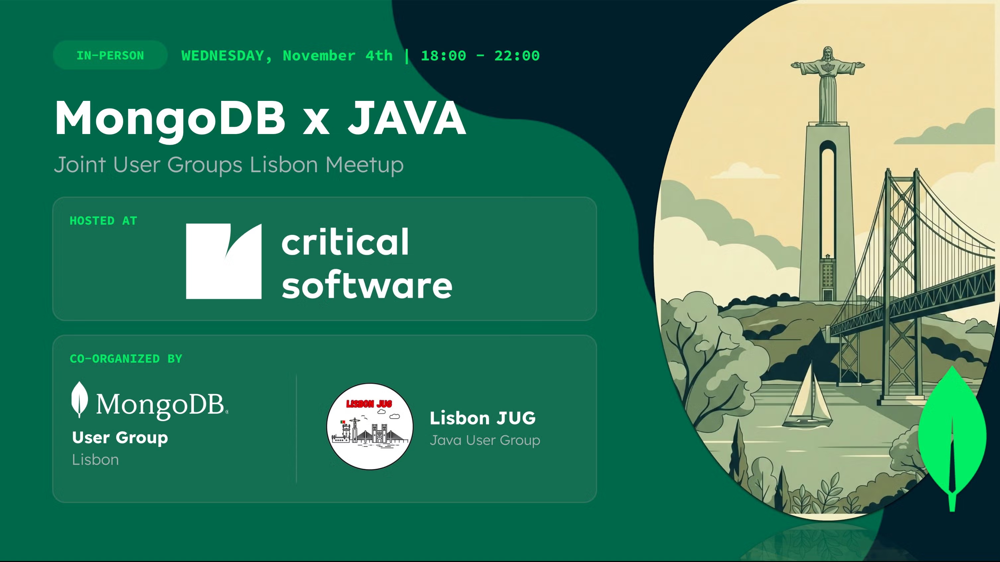
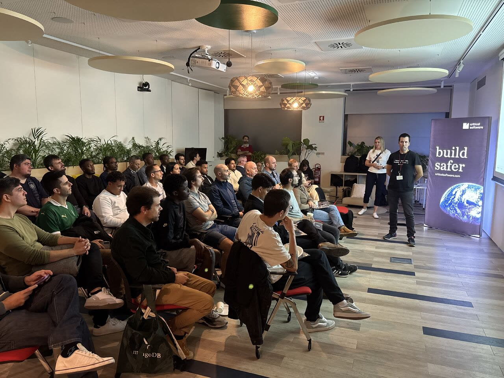
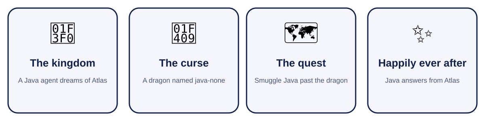
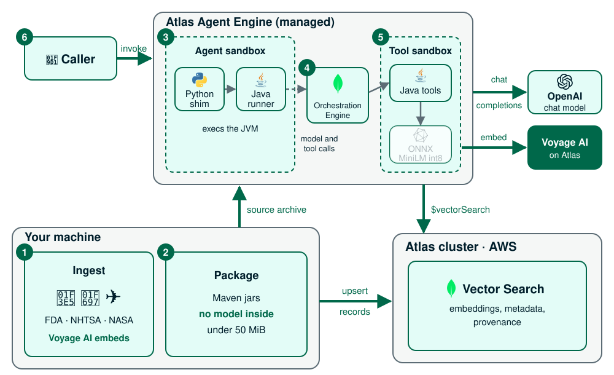

# Jongo

Slides for the **Java vs. MongoDB** talk given on November 4th 2026 at the [MongoDB User Group Lisbon × Java User Group Lisbon](https://www.meetup.com/mongodb-usergroup-lisbon/events/316995288) meetup, hosted by Critical Software in Lisbon.

🎤 **Live deck:** https://jgalego.github.io/jongo

💻 **Code:** [agent-engine-client-libraries](https://github.com/JGalego/agent-engine-client-libraries)




## Overview

> Will Java and MongoDB end up living happily ever after?



## Architecture



## Take it, tweak it

The deck is available in PDF format so you can read it offline:

| File | What |
| --- | --- |
| [talk-final.pdf](pdf/talk-final.pdf) | one page per slide, every fragment shown |
| [talk-redux.pdf](pdf/talk-redux.pdf) | the short version |
| [talk-steps.pdf](pdf/talk-steps.pdf) | one page per click |

Slides live in `slides.md`, theme and behaviour in `index.html`. Serve the folder to preview:

```sh
python3 -m http.server 8790   # then open http://localhost:8790
```

To rebuild the PDFs, you'll need Chrome or Chromium:

```sh
./print-pdf.sh all            # or: steps | final | redux
THEME=java ./print-pdf.sh all # Java theme
NOTES=1 ./print-pdf.sh final  # speaker notes on their own pages
```

## Thank you

🙏 To the [MongoDB User Group Lisbon](https://www.meetup.com/mongodb-usergroup-lisbon/) and the [Lisbon JUG](https://www.meetup.com/lisbon-jug/) for putting the evening together, to [Critical Software](https://www.criticalsoftware.com) for hosting us, and to everyone who came. João Mourão (MongoDB) asked for a Disney movie, so he got one.
